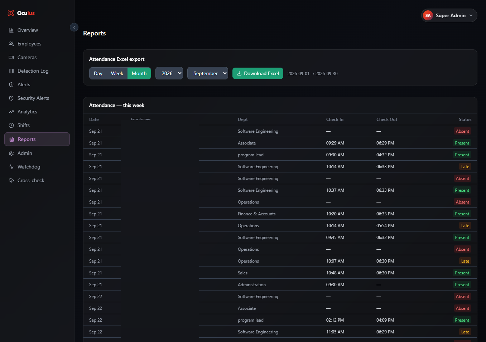
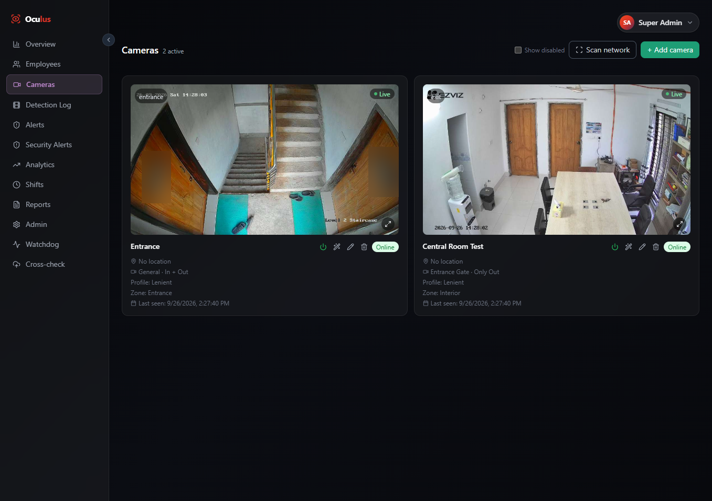
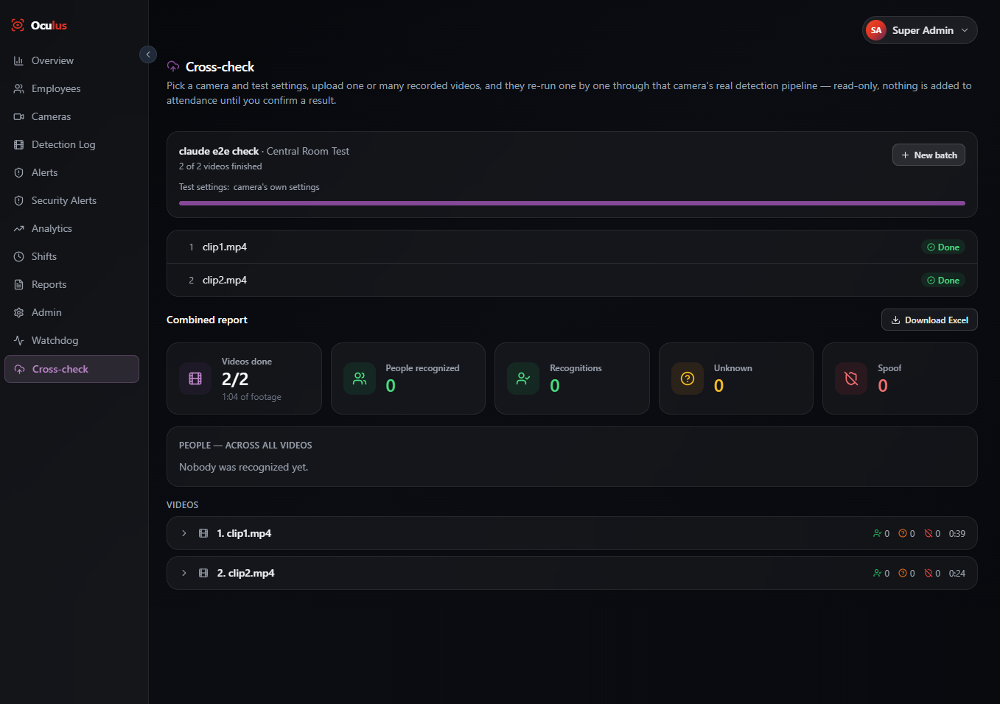
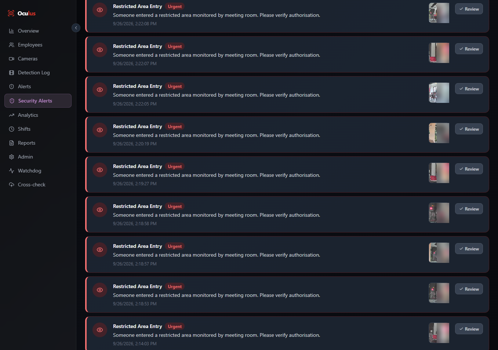
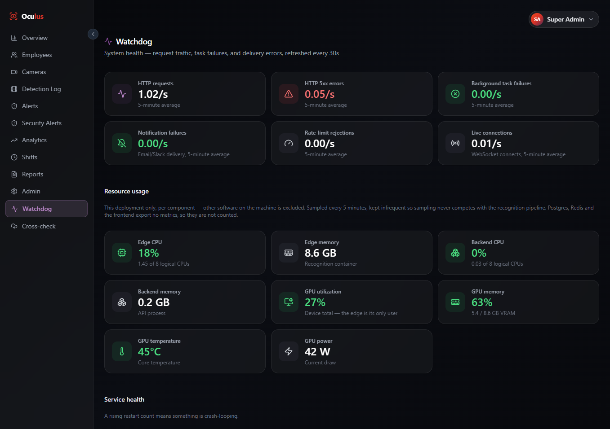
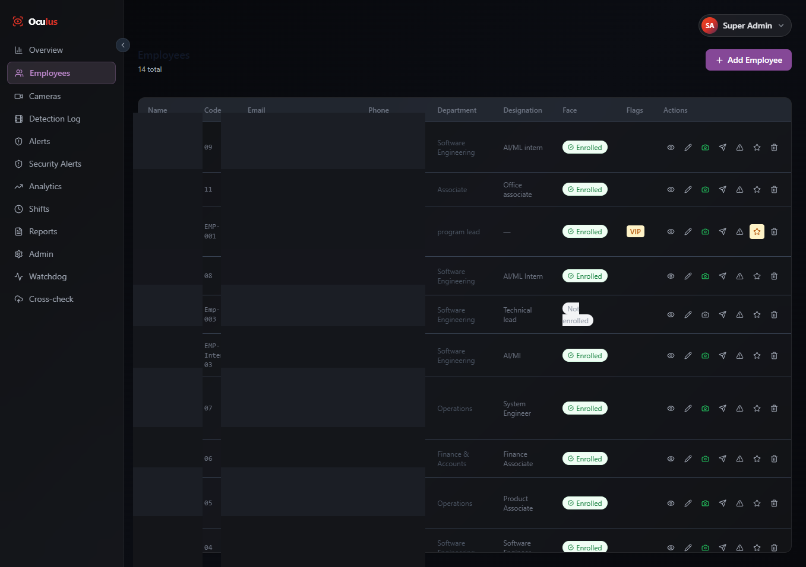
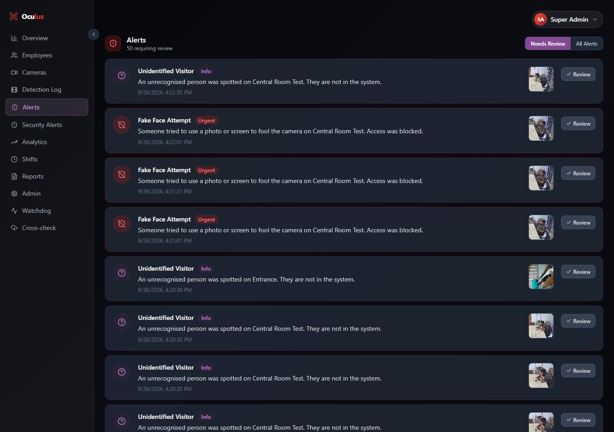
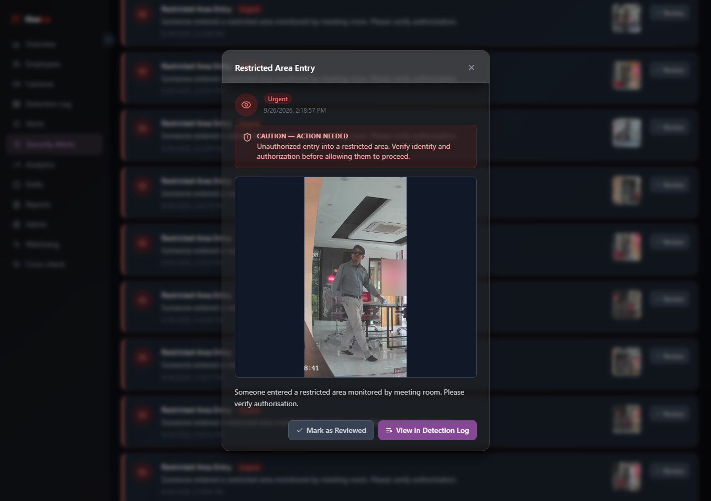

# Oculus — Smart Vision Attendance & Security System

  

Oculus is an AI-powered attendance and security system. It uses live cameras to recognize faces, track people, and send instant alerts. No badges or fingerprints needed — just a camera.

## 📸 Gallery

### Core Dashboard & Analytics

  
  

### Real-Time Detection & Cameras

  

  
  

### Security & Alerts

  
  

### Employee Management

  
  

<b>View More Screenshots</b>

 

  

  

  

---

## ⚡ What It Does

- **Face Recognition** — Spots and identifies employees in real time using YOLOv11 and AdaFace.
- **Attendance Tracking** — Logs check-in and check-out times automatically, with late/early/overtime calculation.
- **Security Alerts** — Warns staff about intruders, blacklisted people, masked faces, suspicious bags, and after-hours activity.
- **Anti-Spoofing** — Blocks fake attempts using photos or videos of a face.
- **Works in Low Light** — Automatically boosts dark video frames so people are still detected at night.
- **Smart Camera Setup** — New cameras can auto-tune themselves just from one snapshot.
- **Keeps Learning** — The system slowly improves its own accuracy over time from real footage.
- **Cross-Check Tool** — Re-run old recordings through the AI to double-check who really showed up.
- **Live Dashboard** — A clean web dashboard with charts, alerts, and employee history.
- **Multi-Branch Support** — Works across multiple office locations, each with its own timezone.

## 🛠 Tech Stack

- **AI / Vision:** YOLOv11, ByteTrack, AdaFace, MediaPipe
- **Backend:** FastAPI (Python)
- **Frontend:** Next.js 15
- **Database:** PostgreSQL + pgvector
- **Infrastructure:** Docker, Redis, Celery

## ⚙️ How It Works (Simple Version)

1. A camera captures a live video feed.
2. The system detects people and faces in each frame.
3. Faces are matched against enrolled employees.
4. Attendance is logged, or an alert is sent if something looks suspicious.
5. Everything shows up live on the dashboard.

## ✨ Key Highlights

- Runs on regular IP cameras (RTSP, ONVIF, USB, and more).
- Supports NVIDIA, AMD, and Intel GPUs — or plain CPU.
- Role-based access so only the right people see sensitive data.
- Built for real-world messiness: bad lighting, cheap cameras, and unstable WiFi.

---

## 🔒 Note

This project is shared here only to show my work. The code, setup details, and internal logic are private and not open source. Please don't copy, reuse, or redistribute any part of this project without permission.

© All rights reserved.
